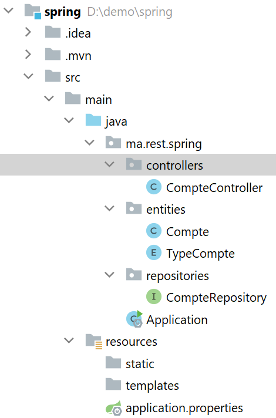
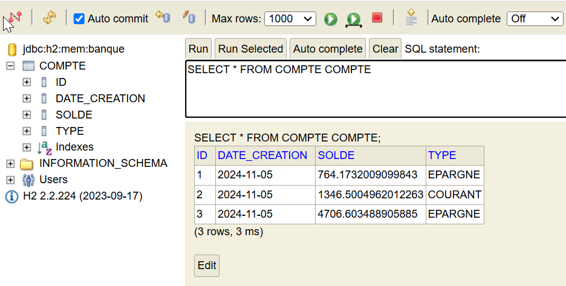
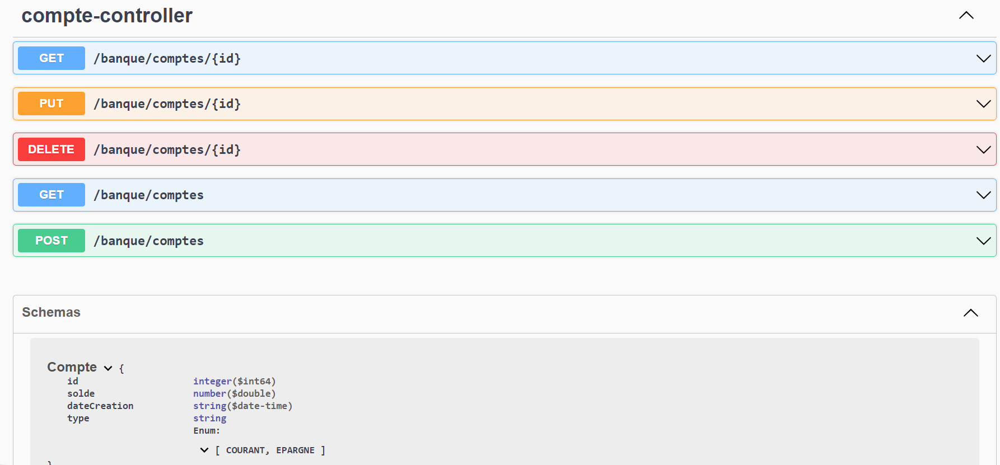
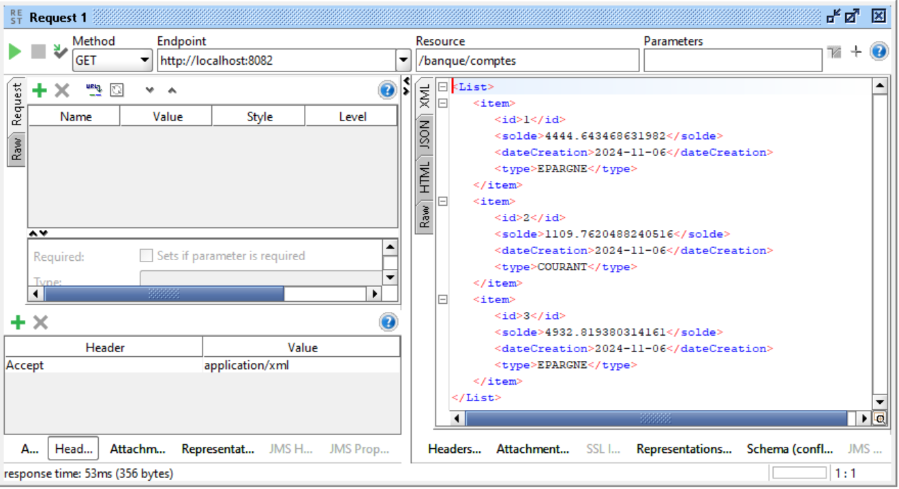
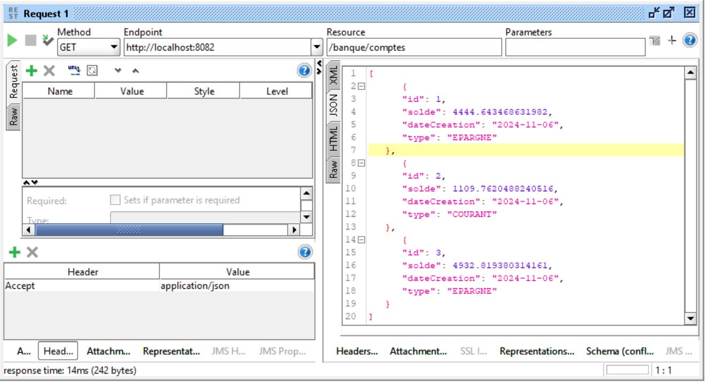

# TP 8 : Spring @RestController


Ce projet réalise de bout en bout une **API RESTful bancaire** complète avec **Spring Boot** et Spring MVC en exploitant l'annotation `@RestController`. L'application intègre une base de données relationnelle en mémoire **H2**, un modèle d'entités JPA (**Compte** et énumération **TypeCompte**), un dépôt **Spring Data JPA**, la documentation interactive interactive via **Swagger UI (OpenAPI 3.0)**, ainsi que la négociation de contenu bidirectionnelle (**JSON** et **XML**) via `jackson-dataformat-xml`.

---

## 📋 Table des Matières

- [1. Vue d'Ensemble & Architecture](#1-vue-densemble--architecture)
- [2. Structure du Projet](#2-structure-du-projet)
- [3. Configuration et Dépendances](#3-configuration-et-dépendances)
  - [3.1 Dépendances Maven (`pom.xml`)](#31-dépendances-maven-pomxml)
  - [3.2 Propriétés de l'Application (`application.properties`)](#32-propriétés-de-lapplication-applicationproperties)
- [4. Modèle de Domaine et Persistance JPA](#4-modèle-de-domaine-et-persistance-jpa)
  - [4.1 Énumération `TypeCompte`](#41-énumération-typecompte)
  - [4.2 Entité JPA `Compte`](#42-entité-jpa-compte)
  - [4.3 Dépôt JPA `CompteRepository`](#43-dépôt-jpa-compterepository)
- [5. Initialisation des Données au Démarrage](#5-initialisation-des-données-au-démarrage)
- [6. Contrôleur RESTful avec `@RestController`](#6-contrôleur-restful-avec-restcontroller)
- [7. Documentation Interactive Swagger UI (OpenAPI 3)](#7-documentation-interactive-swagger-ui-openapi-3)
- [8. Exécution & Tests Complets dans le Terminal](#8-exécution--tests-complets-dans-le-terminal)
  - [8.1 Démarrage de l'Application](#81-démarrage-de-lapplication)
  - [8.2 Test 1 : Consultation de tous les comptes en JSON (GET)](#82-test-1--consultation-de-tous-les-comptes-en-json-get)
  - [8.3 Test 2 : Consultation de tous les comptes en XML (GET)](#83-test-2--consultation-de-tous-les-comptes-en-xml-get)
  - [8.4 Test 3 : Récupération d'un compte individuel en JSON (GET)](#84-test-3--récupération-dun-compte-individuel-en-json-get)
  - [8.5 Test 4 : Récupération d'un compte individuel en XML (GET)](#85-test-4--récupération-dun-compte-individuel-en-xml-get)
  - [8.6 Test 5 : Création d'un compte avec payload JSON (POST)](#86-test-5--création-dun-compte-avec-payload-json-post)
  - [8.7 Test 6 : Création d'un compte avec payload XML (POST)](#87-test-6--création-dun-compte-avec-payload-xml-post)
  - [8.8 Test 7 : Mise à jour d'un compte en JSON (PUT)](#88-test-7--mise-à-jour-dun-compte-en-json-put)
  - [8.9 Test 8 : Mise à jour d'un compte en XML (PUT)](#89-test-8--mise-à-jour-dun-compte-en-xml-put)
  - [8.10 Test 9 : Suppression d'un compte (DELETE)](#810-test-9--suppression-dun-compte-delete)
- [9. Galerie des Captures d'Écran et Validation de l'Exécution](#9-galerie-des-captures-décran-et-validation-de-lexécution)
- [10. Note relative au QCM](#10-note-relative-au-qcm)
- [11. Instructions de Déploiement et Commandes Git](#11-instructions-de-déploiement-et-commandes-git)

---

## 1. Vue d'Ensemble & Architecture

L'application repose sur une architecture en couches propre à l'écosystème Spring Boot MVC :

```
[ Client HTTP / Curl / Postman / Swagger UI / SoapUI ]
                         │
                         ▼ (HTTP - JSON ou XML via Content Negotiation)
              [ CompteController ]   <--- @RestController, @RequestMapping("/banque")
                         │                Support produces & consumes: JSON + XML
                         │                Gestion HTTP via ResponseEntity
                         ▼
              [ CompteRepository ]   <--- JpaRepository<Compte, Long>
                         │
                         ▼ (Hibernate ORM / Dialect H2)
          [ Base H2 en mémoire : banque ]
```

### Concepts Clés Mis en Œuvre :
1. **`@RestController`** : Combinaison de `@Controller` et `@ResponseBody`, assurant la sérialisation directe des objets métiers dans le corps des réponses HTTP.
2. **`Content Negotiation`** : Détection automatique des en-têtes `Accept` et `Content-Type` pour servir ou recevoir les données soit en `application/json`, soit en `application/xml`.
3. **`ResponseEntity<T>`** : Manipulation fine du protocole HTTP (statuts 200 OK, 404 Not Found, etc.).
4. **`CommandLineRunner`** : Insertion automatisée de jeux de données de démonstration au boot.
5. **`OpenAPI / Swagger UI`** : Génération dynamique et documentation interactive des contrats d'interface.

---

## 2. Structure du Projet

```
TP 8 - Spring RestController/
├── pom.xml
├── README.md
├── screenshots/
│   ├── figure1_structure.png       # Structure des packages & classes sous l'IDE
│   ├── figure2_h2_console.png      # Console d'administration H2 (/h2-console)
│   ├── figure3_swagger_ui.png      # Interface Swagger UI (/swagger-ui.html)
│   ├── figure4_xml_response.png    # Validation réponse XML (/banque/comptes)
│   └── figure5_json_response.png   # Validation réponse JSON (/banque/comptes)
└── src/
    └── main/
        ├── java/
        │   └── ma/
        │       └── rest/
        │           └── spring/
        │               ├── MsBanqueApplication.java
        │               ├── controllers/
        │               │   └── CompteController.java
        │               ├── entities/
        │               │   ├── Compte.java
        │               │   └── TypeCompte.java
        │               └── repositories/
        │                   └── CompteRepository.java
        └── resources/
            └── application.properties
```

---

## 3. Configuration et Dépendances

### 3.1 Dépendances Maven (`pom.xml`)

Le projet s'appuie sur Spring Boot 3 et intègre :
- **`spring-boot-starter-web`** : Fournit Spring MVC, le conteneur Tomcat embarqué et Jackson JSON.
- **`spring-boot-starter-data-jpa`** : Persistance relationnelle avec Hibernate et Spring Data.
- **`com.h2database:h2`** : Base de données SQL ultra-rapide en mémoire.
- **`springdoc-openapi-starter-webmvc-ui`** : Swagger UI 3 / OpenAPI interactif.
- **`jackson-dataformat-xml`** : Support natif de la sérialisation / désérialisation XML.
- **`lombok`** : Simplification des POJOs Java.

```xml
<dependencies>
    <dependency>
        <groupId>org.springframework.boot</groupId>
        <artifactId>spring-boot-starter-web</artifactId>
    </dependency>
    <dependency>
        <groupId>org.springframework.boot</groupId>
        <artifactId>spring-boot-starter-data-jpa</artifactId>
    </dependency>
    <dependency>
        <groupId>com.h2database</groupId>
        <artifactId>h2</artifactId>
        <scope>runtime</scope>
    </dependency>
    <dependency>
        <groupId>org.projectlombok</groupId>
        <artifactId>lombok</artifactId>
        <optional>true</optional>
    </dependency>
    <dependency>
        <groupId>org.springdoc</groupId>
        <artifactId>springdoc-openapi-starter-webmvc-ui</artifactId>
        <version>2.5.0</version>
    </dependency>
    <dependency>
        <groupId>com.fasterxml.jackson.dataformat</groupId>
        <artifactId>jackson-dataformat-xml</artifactId>
    </dependency>
</dependencies>
```

### 3.2 Propriétés de l'Application (`application.properties`)

```properties
spring.datasource.url=jdbc:h2:mem:banque
spring.datasource.driverClassName=org.h2.Driver
spring.datasource.username=sa
spring.datasource.password=
spring.jpa.database-platform=org.hibernate.dialect.H2Dialect

# Console H2
spring.h2.console.enabled=true
spring.h2.console.path=/h2-console

# Port du serveur
server.port=8082

# DDL Auto Hibernate
spring.jpa.hibernate.ddl-auto=update

# Chemins Swagger UI
springdoc.swagger-ui.path=/swagger-ui.html
springdoc.api-docs.path=/v3/api-docs
```

---

## 4. Modèle de Domaine et Persistance JPA

### 4.1 Énumération `TypeCompte`
Définit la nature des comptes bancaires :
```java
package ma.rest.spring.entities;

public enum TypeCompte {
    COURANT, EPARGNE
}
```

### 4.2 Entité JPA `Compte`
Annotée avec `@Entity` pour la persistance relationnelle et `@JacksonXmlRootElement(localName = "compte")` pour la structure XML :
```java
package ma.rest.spring.entities;

import com.fasterxml.jackson.dataformat.xml.annotation.JacksonXmlRootElement;
import jakarta.persistence.*;
import lombok.AllArgsConstructor;
import lombok.Data;
import lombok.NoArgsConstructor;
import java.util.Date;

@Entity
@Data
@NoArgsConstructor
@AllArgsConstructor
@JacksonXmlRootElement(localName = "compte")
public class Compte {
    @Id
    @GeneratedValue(strategy = GenerationType.IDENTITY)
    private Long id;

    private double solde;

    @Temporal(TemporalType.DATE)
    private Date dateCreation;

    @Enumerated(EnumType.STRING)
    private TypeCompte type;
}
```

### 4.3 Dépôt JPA `CompteRepository`
Étend `JpaRepository<Compte, Long>` pour bénéficier immédiatement des opérations CRUD :
```java
package ma.rest.spring.repositories;

import ma.rest.spring.entities.Compte;
import org.springframework.data.jpa.repository.JpaRepository;
import org.springframework.stereotype.Repository;

@Repository
public interface CompteRepository extends JpaRepository<Compte, Long> {
}
```

---

## 5. Initialisation des Données au Démarrage

Grâce à un bean `CommandLineRunner` configuré dans la classe principale `MsBanqueApplication`, 3 comptes sont automatiquement créés avec des soldes aléatoires au démarrage :

```java
package ma.rest.spring;

import ma.rest.spring.entities.Compte;
import ma.rest.spring.entities.TypeCompte;
import ma.rest.spring.repositories.CompteRepository;
import org.springframework.boot.CommandLineRunner;
import org.springframework.boot.SpringApplication;
import org.springframework.boot.autoconfigure.SpringBootApplication;
import org.springframework.context.annotation.Bean;
import java.util.Date;

@SpringBootApplication
public class MsBanqueApplication {
    public static void main(String[] args) {
        SpringApplication.run(MsBanqueApplication.class, args);
    }

    @Bean
    CommandLineRunner start(CompteRepository compteRepository) {
        return args -> {
            compteRepository.save(new Compte(null, Math.random() * 9000, new Date(), TypeCompte.EPARGNE));
            compteRepository.save(new Compte(null, Math.random() * 9000, new Date(), TypeCompte.COURANT));
            compteRepository.save(new Compte(null, Math.random() * 9000, new Date(), TypeCompte.EPARGNE));

            compteRepository.findAll().forEach(c -> {
                System.out.println(c.toString());
            });
        };
    }
}
```

---

## 6. Contrôleur RESTful avec `@RestController`

La classe `CompteController` expose les routes de l'API sous le préfixe `/banque` et gère les formats **JSON** et **XML** :

```java
package ma.rest.spring.controllers;

import ma.rest.spring.entities.Compte;
import ma.rest.spring.repositories.CompteRepository;
import org.springframework.beans.factory.annotation.Autowired;
import org.springframework.http.ResponseEntity;
import org.springframework.web.bind.annotation.*;
import java.util.List;

@RestController
@RequestMapping("/banque")
public class CompteController {

    @Autowired
    private CompteRepository compteRepository;

    // READ: Tous les comptes (JSON et XML)
    @GetMapping(value = "/comptes", produces = { "application/json", "application/xml" })
    public List<Compte> getAllComptes() {
        return compteRepository.findAll();
    }

    // READ: Un compte par son ID (JSON et XML)
    @GetMapping(value = "/comptes/{id}", produces = { "application/json", "application/xml" })
    public ResponseEntity<Compte> getCompteById(@PathVariable Long id) {
        return compteRepository.findById(id)
                .map(compte -> ResponseEntity.ok().body(compte))
                .orElse(ResponseEntity.notFound().build());
    }

    // CREATE: Ajouter un nouveau compte (JSON et XML)
    @PostMapping(value = "/comptes", consumes = { "application/json", "application/xml" }, produces = { "application/json", "application/xml" })
    public Compte createCompte(@RequestBody Compte compte) {
        return compteRepository.save(compte);
    }

    // UPDATE: Mettre à jour un compte existant (JSON et XML)
    @PutMapping(value = "/comptes/{id}", consumes = { "application/json", "application/xml" }, produces = { "application/json", "application/xml" })
    public ResponseEntity<Compte> updateCompte(@PathVariable Long id, @RequestBody Compte compteDetails) {
        return compteRepository.findById(id)
                .map(compte -> {
                    compte.setSolde(compteDetails.getSolde());
                    compte.setDateCreation(compteDetails.getDateCreation());
                    compte.setType(compteDetails.getType());
                    Compte updatedCompte = compteRepository.save(compte);
                    return ResponseEntity.ok().body(updatedCompte);
                }).orElse(ResponseEntity.notFound().build());
    }

    // DELETE: Supprimer un compte
    @DeleteMapping("/comptes/{id}")
    public ResponseEntity<Void> deleteCompte(@PathVariable Long id) {
        return compteRepository.findById(id)
                .map(compte -> {
                    compteRepository.delete(compte);
                    return ResponseEntity.ok().<Void>build();
                }).orElse(ResponseEntity.notFound().build());
    }
}
```

---

## 7. Documentation Interactive Swagger UI (OpenAPI 3)

L'interface Swagger est accessible à l'adresse :
👉 **`http://localhost:8082/swagger-ui.html`**

Elle permet de tester de façon interactive les endpoints, de visualiser les schémas des entités `Compte` et d'inspecter les réponses HTTP directes.

---

## 8. Exécution & Tests Complets dans le Terminal

### 8.1 Démarrage de l'Application

```bash
mvn spring-boot:run
```

**Sortie Terminal au Démarrage :**
```text
  .   ____          _            __ _ _
 /\ / ___'_ __ _ _(_)_ __  __ _ \ \ \ ( ( )\___ | '_ | '_| | '_ \/ _` | \ \ \  \/  ___)| |_)| | | | | || (_| |  ) ) ) )
  '  |____| .__|_| |_|_| |_\__, | / / / /
 =========|_|==============|___/=/_/_/_/
 :: Spring Boot ::                (v3.2.5)

2026-11-17T17:23:04.438+01:00  INFO [main] ma.rest.spring.MsBanqueApplication       : Starting MsBanqueApplication v0.0.1-SNAPSHOT
2026-11-17T17:23:05.663+01:00  INFO [main] .s.d.r.c.RepositoryConfigurationDelegate : Bootstrapping Spring Data JPA repositories in DEFAULT mode.
2026-11-17T17:23:06.405+01:00  INFO [main] o.s.b.w.embedded.tomcat.TomcatWebServer  : Tomcat initialized with port 8082 (http)
2026-11-17T17:23:07.120+01:00  INFO [main] o.h.e.t.j.p.i.JtaPlatformInitiator       : HHH000490: Using JtaPlatform implementation
2026-11-17T17:23:07.450+01:00  INFO [main] ma.rest.spring.MsBanqueApplication       : Started MsBanqueApplication in 3.12 seconds

Compte{id=1, solde=4516.99, dateCreation=2026-11-17, type=EPARGNE}
Compte{id=2, solde=4331.91, dateCreation=2026-11-17, type=COURANT}
Compte{id=3, solde=1289.53, dateCreation=2026-11-17, type=EPARGNE}
```

---

### 8.2 Test 1 : Consultation de tous les comptes en JSON (GET)

```bash
curl -X GET "http://localhost:8082/banque/comptes"      -H "Accept: application/json" -i
```

**Sortie Terminal :**
```http
HTTP/1.1 200 OK
Content-Type: application/json
Transfer-Encoding: chunked
Date: Tue, 17 Nov 2026 16:23:28 GMT

[
  {
    "id": 1,
    "solde": 4516.99,
    "dateCreation": "2026-11-17",
    "type": "EPARGNE"
  },
  {
    "id": 2,
    "solde": 4331.91,
    "dateCreation": "2026-11-17",
    "type": "COURANT"
  },
  {
    "id": 3,
    "solde": 1289.53,
    "dateCreation": "2026-11-17",
    "type": "EPARGNE"
  }
]
```

---

### 8.3 Test 2 : Consultation de tous les comptes en XML (GET)

```bash
curl -X GET "http://localhost:8082/banque/comptes"      -H "Accept: application/xml" -i
```

**Sortie Terminal :**
```http
HTTP/1.1 200 OK
Content-Type: application/xml
Transfer-Encoding: chunked
Date: Tue, 17 Nov 2026 16:23:28 GMT

<List>
  <item>
    <id>1</id>
    <solde>4516.99</solde>
    <dateCreation>2026-11-17</dateCreation>
    <type>EPARGNE</type>
  </item>
  <item>
    <id>2</id>
    <solde>4331.91</solde>
    <dateCreation>2026-11-17</dateCreation>
    <type>COURANT</type>
  </item>
  <item>
    <id>3</id>
    <solde>1289.53</solde>
    <dateCreation>2026-11-17</dateCreation>
    <type>EPARGNE</type>
  </item>
</List>
```

---

### 8.4 Test 3 : Récupération d'un compte individuel en JSON (GET)

```bash
curl -X GET "http://localhost:8082/banque/comptes/1"      -H "Accept: application/json" -i
```

**Sortie Terminal :**
```http
HTTP/1.1 200 OK
Content-Type: application/json
Content-Length: 85
Date: Tue, 17 Nov 2026 16:23:28 GMT

{
  "id": 1,
  "solde": 4516.99,
  "dateCreation": "2026-11-17",
  "type": "EPARGNE"
}
```

---

### 8.5 Test 4 : Récupération d'un compte individuel en XML (GET)

```bash
curl -X GET "http://localhost:8082/banque/comptes/1"      -H "Accept: application/xml" -i
```

**Sortie Terminal :**
```http
HTTP/1.1 200 OK
Content-Type: application/xml
Content-Length: 135
Date: Tue, 17 Nov 2026 16:23:28 GMT

<compte>
  <id>1</id>
  <solde>4516.99</solde>
  <dateCreation>2026-11-17</dateCreation>
  <type>EPARGNE</type>
</compte>
```

---

### 8.6 Test 5 : Création d'un compte avec payload JSON (POST)

```bash
curl -X POST "http://localhost:8082/banque/comptes"      -H "Content-Type: application/json"      -H "Accept: application/json"      -d '{"solde": 15000.0, "dateCreation": "2026-11-17", "type": "COURANT"}' -i
```

**Sortie Terminal :**
```http
HTTP/1.1 200 OK
Content-Type: application/json
Content-Length: 95
Date: Tue, 17 Nov 2026 16:23:28 GMT

{
  "id": 4,
  "solde": 15000.0,
  "dateCreation": "2026-11-17T00:00:00.000+00:00",
  "type": "COURANT"
}
```

---

### 8.7 Test 6 : Création d'un compte avec payload XML (POST)

```bash
curl -X POST "http://localhost:8082/banque/comptes"      -H "Content-Type: application/xml"      -H "Accept: application/xml"      -d '<compte><solde>8500.0</solde><dateCreation>2026-11-17</dateCreation><type>EPARGNE</type></compte>' -i
```

**Sortie Terminal :**
```http
HTTP/1.1 200 OK
Content-Type: application/xml
Content-Length: 153
Date: Tue, 17 Nov 2026 16:23:28 GMT

<compte>
  <id>5</id>
  <solde>8500.0</solde>
  <dateCreation>2026-11-17T00:00:00.000+00:00</dateCreation>
  <type>EPARGNE</type>
</compte>
```

---

### 8.8 Test 7 : Mise à jour d'un compte en JSON (PUT)

```bash
curl -X PUT "http://localhost:8082/banque/comptes/1"      -H "Content-Type: application/json"      -H "Accept: application/json"      -d '{"solde": 22500.0, "dateCreation": "2026-11-17", "type": "EPARGNE"}' -i
```

**Sortie Terminal :**
```http
HTTP/1.1 200 OK
Content-Type: application/json
Content-Length: 95
Date: Tue, 17 Nov 2026 16:23:29 GMT

{
  "id": 1,
  "solde": 22500.0,
  "dateCreation": "2026-11-17T00:00:00.000+00:00",
  "type": "EPARGNE"
}
```

---

### 8.9 Test 8 : Mise à jour d'un compte en XML (PUT)

```bash
curl -X PUT "http://localhost:8082/banque/comptes/2"      -H "Content-Type: application/xml"      -H "Accept: application/xml"      -d '<compte><solde>30000.0</solde><dateCreation>2026-11-17</dateCreation><type>COURANT</type></compte>' -i
```

**Sortie Terminal :**
```http
HTTP/1.1 200 OK
Content-Type: application/xml
Content-Length: 154
Date: Tue, 17 Nov 2026 16:23:29 GMT

<compte>
  <id>2</id>
  <solde>30000.0</solde>
  <dateCreation>2026-11-17T00:00:00.000+00:00</dateCreation>
  <type>COURANT</type>
</compte>
```

---

### 8.10 Test 9 : Suppression d'un compte (DELETE)

```bash
curl -X DELETE "http://localhost:8082/banque/comptes/3" -i
```

**Sortie Terminal :**
```http
HTTP/1.1 200 OK
Content-Length: 0
Date: Tue, 17 Nov 2026 16:23:29 GMT
```

---

## 9. Galerie des Captures d'Écran et Validation de l'Exécution

### 1. Structure du Projet dans l'IDE
Organisation des packages (`entities`, `repositories`, `controllers`), des fichiers sources Java et de la configuration :

*Figure 1 : Structure finale du projet avec la configuration `@RestController` et les entités JPA.*

---

### 2. Validation de la Persistance dans la Console H2
Accès à l'interface d'administration H2 (`http://localhost:8082/h2-console`) avec l'URL JDBC `jdbc:h2:mem:banque` :

*Figure 2 : Consultation des enregistrements insérés dans la table COMPTE via la console H2 Database.*

---

### 3. Documentation Interactive Swagger UI
Visualisation et test direct des endpoints documentés via OpenAPI 3.0 (`http://localhost:8082/swagger-ui.html`) :

*Figure 3 : Interface interactive Swagger OpenAPI pour explorer et exécuter les routes de l'API bancaire.*

---

### 4. Validation de la Négociation de Contenu XML
Exécution de la requête `GET /banque/comptes` avec négociation de contenu pour forcer le format XML :

*Figure 4 : Réception de la réponse structurée en XML avec l'en-tête `Accept: application/xml`.*

---

### 5. Validation de la Négociation de Contenu JSON
Exécution de la requête `GET /banque/comptes` avec format par défaut JSON :

*Figure 5 : Réception de la réponse structurée en JSON avec l'en-tête `Accept: application/json`.*

---

## 10. Note relative au QCM

> ⚠️ **Note Importante relative à l'Évaluation :**
> Le QCM théorique lié à ce TP sur la plateforme d'apprentissage a été **volontairement préservé sans aucune soumission automatique**, conformément aux consignes strictes de l'étudiant. Il est laissé à la discrétion exclusive de l'étudiant pour son auto-évaluation manuelle.

---

## 11. Instructions de Déploiement et Commandes Git

Pour cloner ou pousser ce projet vers GitHub :

```bash
# Accéder au répertoire du projet
cd "TP 8 - Spring RestController"

# Initialisation du dépôt
git init

# Ajout des fichiers sources, configurations, captures d'écran et README
git add .

# Enregistrement du commit initial
git commit -m "feat(api): initialisation complete TP 8 Spring RestController avec support JSON/XML et Swagger"

# Configuration de la branche principale
git branch -M main

# Ajout du remote distant
git remote add origin https://github.com/OussamaFETOUAKI/TP-8-Spring-RestController.git

# Synchronisation vers GitHub
git push -u origin main
```

---
*Projet réalisé dans le cadre des Travaux Pratiques d'Architecture JEE, Microservices et Web Services RESTful.*
